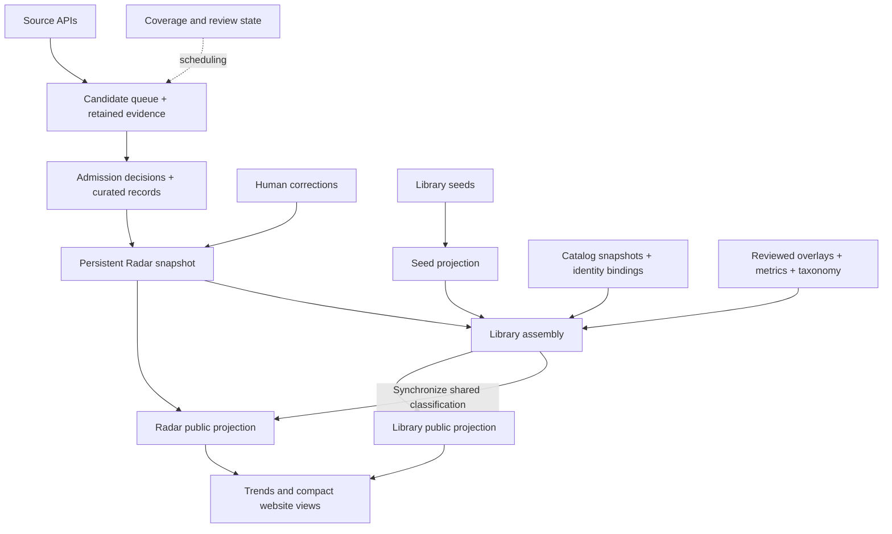

# Data model and update ownership

This document describes the code on the #29 PR branch, based on #28. It does not
claim the branch is deployed or that historical coverage is complete. The
machine-readable asset contract is `pipeline/data_contract.json`; the current
snapshot has 243 tracked data files. The contract covers dated file patterns and
optional runtime files as well as today's files. Literal `codeReferences` in that
contract are navigation aids, not a complete call graph or proof of read access.

## The actual persistence model

The repository stores several different kinds of state in Git. A JSON filename
alone does not establish authority. In particular, a file named `audit` can be an
active classification input, and a file named `index` can contain retained hidden
records rather than only the visible website.

| Object | Current representation and key | Meaning and limitation |
|---|---|---|
| Benchmark record | `benchmarks`, seeds, reviewed additions, catalog records; stable `id` | An application record, not a globally verified scientific identity. Source-native ingestion currently assumes one record per source key. |
| Family/version/track | `familyId`, `variantOf`, `recordType`, `evaluationRole`, `benchmarkParentId` | Partially represented today. `familyId` is a grouping/lookup key, not necessarily a foreign key to a stored row. A subset must not silently acquire the parent's scope. |
| Source identity | Provider namespace + provider ID through `source_identity.source_key` | A paper/repository/dataset, not a benchmark entity. One paper can introduce several benchmarks; the current source-upsert model cannot express that fully. |
| Source observation | Candidate `reviewContext`, source revision/hash and `source_evidence.bySource` | Latest retained text per source; **not** an immutable history of every retrieved version. A paper revision is not a new first release. |
| Identity decision | Catalog bindings and reviewed identity redirects | Legacy compatibility and source-reviewed merges have different authority. Names, common URLs or equal task counts are insufficient. |
| Review decision | `editorial_copy.bySourceKey`, legacy `bySourceId`, curated records and human overlays | Publish/defer/exclude, evidence, input/policy hash, reviewed copy. Operational attempts are separate. A review response alone is not a completed publication transaction. |
| Operational work | Coverage windows, review queue/state, source refresh state | Retryable acquisition/review work. Queue membership does not mean “still undecided”: reviewed candidates are retained. A completed source window does not mean all its candidates were admitted. |
| Classification | Navigation assignments, topic reviews, evidence facets | Navigation membership, featured topics and source-backed domain/task facts are different projections. Model-generated facets are not independent scientific verification. |
| Measurements and model reports | Metrics/history, `usage/`, model evaluation inputs | Stars, report mentions and scoped model scores are different observations. None establishes unobserved internal evaluation use or saturation. |
| Publication | Radar/Library JSON and compact `_site/data` projections | Generated from the above. Stored row count includes hidden outcomes; frontend eligibility is separate. |

Conceptually, sources and benchmarks require a many-to-many relationship with
scoped evidence edges. That is a **future modeling requirement**, not a claim
that today's source-key upserts or 70 legacy catalog bindings implement it.
Database evaluation (#31) must preserve this distinction, version/subset context
and existing public IDs rather than treating provider IDs as benchmark PKs.

## Data flow and actual readers



The actual generator order is important:

1. Discovery persists evidence/candidates before coverage receipts; known-source
   refresh persists candidates before advancing refresh hashes.
2. Deterministic admission updates `benchmarks.json` and queue metadata. Model
   review writes curated publication results, then editorial decisions, then
   attempt state. These are sequential writes, **not a cross-file transaction**.
3. `apply_overrides.py` upserts curated records into the current Radar snapshot,
   applies eligible editorial copy, then curated overrides, then separate
   attention forecasts. The current snapshot is an input, not disposable output.
4. `build_library_records.py` reads seeds and Radar, retaining seed records not
   already reconciled into Radar. Its output currently has 55 records; it is not
   the 4,104-record Library.
5. `generate_public_index.py` projects Radar. `generate_library_index.py` reads
   Radar, seed projection and catalogs; applies bindings and reviewed merges;
   adds/reviews source records; applies aliases, repository evidence and metrics;
   applies release evidence and paper links; classifies; attaches retained-source
   facets/search documents and growth. It then synchronizes shared classification
   into Radar's public JSON, and attaches imported usage and model-report links
   to Library. See its `main()` for the exact current order.
6. Trends reads generated Library/Radar data and histories. `site_views.py` and
   `build_github_pages.py` generate compact website files. Browser/CLI/Trends
   retrieval share search policy but use their respective generated projections.

Additional indirect readers: `repository_index`, `library_metrics`,
`library_release_dates`, `library_source_reviews`, `paper_links`,
`research_directions`, `research_topics`, `library_categories`, `evidence_facets`,
`signal_history`, and `usage_store` are called by Library assembly. These helpers
read overlays/snapshots even when their filenames do not appear in the caller.
`classify_categories` reads the generated Library to produce reviewed navigation
assignments, after which the views must be rebuilt. `update_model_evals` reads
reviewed update inputs plus the embedded historical model dataset and generates
model-report references; those references are not themselves primary evidence.

## Field authority and update rules

| Field / operation | Owning input or operation | Precedence / restriction |
|---|---|---|
| Record `id` | Original admission/seed/catalog identity; reviewed redirects for later reconciliation | Source refresh preserves existing IDs. Cross-source merging requires an explicit evidence-backed mapping, not a name match. |
| Provider ID/key | Provider observation, normalized by `source_identity` | GitHub/HF case normalized; provider namespaces prevent accidental joins. A provider rename needs verified source history; it is not permission to merge benchmark entities. |
| First release | Original first-release observation; scoped reviewed `library_release_dates` for Library corrections | Never replace with discovery, retrieval or revision time. Reviewed Library dates can intentionally differ from the Radar snapshot. `0001-01-01` is an existing unknown-date sentinel, not a historical release. Preserve precision. |
| First seen / updated / indexed | First discovery / provider revision / processing respectively | These clocks are distinct. Source refresh keeps first-seen/first-release stable; newer evidence cannot be overwritten by an older revision. |
| Canonical name, copy, publisher | Qualified editorial decision, then curated Radar overrides; scoped Library reviews in Library | Library may intentionally use a reviewed display name. Do not enforce universal byte equality across all views or use a copy refresh to change identity. |
| Task/resource/parent links | `library_source_reviews` sections | Resource-only review does not own release dates or task taxonomy. Repository inference fills missing links; it must not replace an existing reviewed link. |
| Visibility | Validated admission / explicit source-backed exclusion and scoped existing overrides | Source failure, defer and attention updates preserve prior validated publication. Library also excludes `viewpoint_probe`. Stored count is not visible count. |
| Navigation category | `taxonomy_v5_assignments` + taxonomy definition | Direct record lookup, then variant/family lookup, then provisional rules. Human/anchor assignments are protected from model refresh. Identity redirects are not automatically followed by this consumer. |
| Domain/task facts | Retained primary text + concept/policy version; hash-matching model facets | Keep source URL, quote, basis and whole-benchmark/subset/unspecified scope. Editorial text is labeled separately. A new source/policy hash invalidates derived facts. |
| Measured attention | Metrics snapshots/history; repository scope decisions | Measured observations must not rewrite publication/identity. Forecasts are separately stored model estimates. |
| Model evaluation claim | Reviewed source and explicit benchmark/version/subset/settings | A report link is not evidence of an internal run, score equivalence across settings, saturation, or membership of individual chip-design questions. |
| Retry/complete status | Coverage and review operational state | Save work before completion receipts. A hash proves byte identity, not source completeness or semantic correctness. |

`curated_overrides` currently applies a broad recursive patch keyed by a legacy
source ID; it is not a field-level write-permission system. Its current keys
include a family correction and explicit visibility decisions. This audit does
not retroactively reject those reviewed inputs or claim that a schema whitelist
already exists. Future ownership enforcement must be incremental and preserve
those decisions. The existing `validate_data` still checks source IDs without
namespaces; the new contract audit uses provider-qualified keys without changing
that legacy validator in this PR.

## Storage classes and retention

`pipeline/data_contract.json` assigns every tracked data path exactly one class,
writer entrypoints and retention rule. A new unmatched asset is a regression.
Reviewed repository changes are explicit writers for hand-maintained inputs;
“reviewed” here describes a workflow, not independent re-verification of every
historical row. The generated inventory includes per-file sizes and byte hashes.

- **Materialized state:** `benchmarks.json` keeps historical admissions plus
  enrichment. Its 2,621 rows are not equivalent to the 1,151 curated rows. Do not
  delete it assuming today's inputs can reconstruct every record and observation.
- **Durable decisions/identity/policy:** seeds, overlays, editorial decisions,
  taxonomy assignments/definitions, reviewed model updates and identity maps.
  Some older `audit` files (`topic_source_audit`, `taxonomy_review_20260915`) are
  active inputs. They cannot be retired solely because their names look archival.
- **Source snapshots/evidence:** catalogs, retained texts, repository facts,
  dated measurements and imported usage. Live APIs may change or disappear;
  “can fetch again” is not equivalent to preserving the observed evidence.
- **Operational state:** persistent queue, attempts, coverage and migration
  receipts. Restarting from a clean Git checkout loses uncommitted progress;
  the current artifact snapshots are recovery material, not automatic restore.
- **Rebuildable projections:** seed projection, public indexes, Trends and
  model-report links. Edit upstream owners and regenerate; do not hand-patch
  these files to correct a source fact or manufacture a search hit.
- **Diagnostics:** fixtures and reports. They explain findings but cannot grant
  publication or resolve identities. Ignored caches under `data/repository_audit`
  and local outputs are outside the product asset contract.

No retention deletion or database migration occurs in this change. Cross-file
commit/recovery and write-conflict enforcement belong to #30, informed by this
model. Database architecture/cost measurement remains #31.

## Read-only audit and regression gate

```sh
python3 pipeline/audit_data_contract.py --output outputs/data-contract-audit.json
make audit-data-contract
```

The first command reports; `--check` (used by the Make target and CI) fails on new
or changed findings. Diagnostics may only be written under ignored `outputs/`;
product inputs are never repaired or rewritten by the audit.

Checks cover ownership, duplicate record/source keys within a collection,
provider-aware legacy decision links, catalog/identity references and cycles,
overlay targets, parent links, source archive hashes, facet quote traceability,
evidence/policy input hashes, shared Radar/Library classification and search
concept consistency, and Radar projection membership/stable fields. Family keys
used for navigation inheritance are not incorrectly treated as dangling entity
foreign keys. Empty inputHash or unknown source evidence is not silently blessed.
This is an incremental integrity audit, not an exhaustive JSON schema or proof
of scientific identity. Existing semantic/static validation remains in place.

Baseline observations on the #28 data snapshot:

| Measure | Count / result |
|---|---:|
| Tracked data files classified | 243 |
| Stored Library records | 4,104 |
| Radar / curated / persistent candidates | 2,621 / 1,151 / 3,718 |
| Distinct active source keys across Radar/curated/queue | 5,759 |
| Retained primary-source texts | 379 |
| Unverified legacy catalog bindings | 70, tracked in #18 |
| Historical decisions without a compatible current source | 32, tracked in #32 |
| Navigation overlay not consumed after a legacy redirect | 1, tracked in #33 |
| Other findings from currently implemented checks | 0 |

The 32 decisions may be renamed, retired, or historical-only; they are not
proven invalid. Old `publish` decisions are not permission to republish them.
The one overlay uses `catalog_eb685c80c34e7b28`, whose preserved catalog binding
points to `bm_when-empathy-misses-the-goal-a-benchmark-f_9c89a493`. The binding is
itself unverified; automatically moving the label would hide that uncertainty.

`pipeline/data_contract_baseline.json` enumerates these **103 unresolved
warnings** by exact diagnostic fingerprint with a reason and issue. There are
no wildcard/count exemptions and error findings cannot be baselined. A changed
unlinked decision changes its fingerprint and fails the gate. A resolved warning
is reported as resolved; it is not an error. Updating this baseline is an explicit
reviewed code change, never an automatic post-build command. CI's full report
retains the actual records and reasons so a passing gate cannot be mistaken for
“all historical data is clean.”
